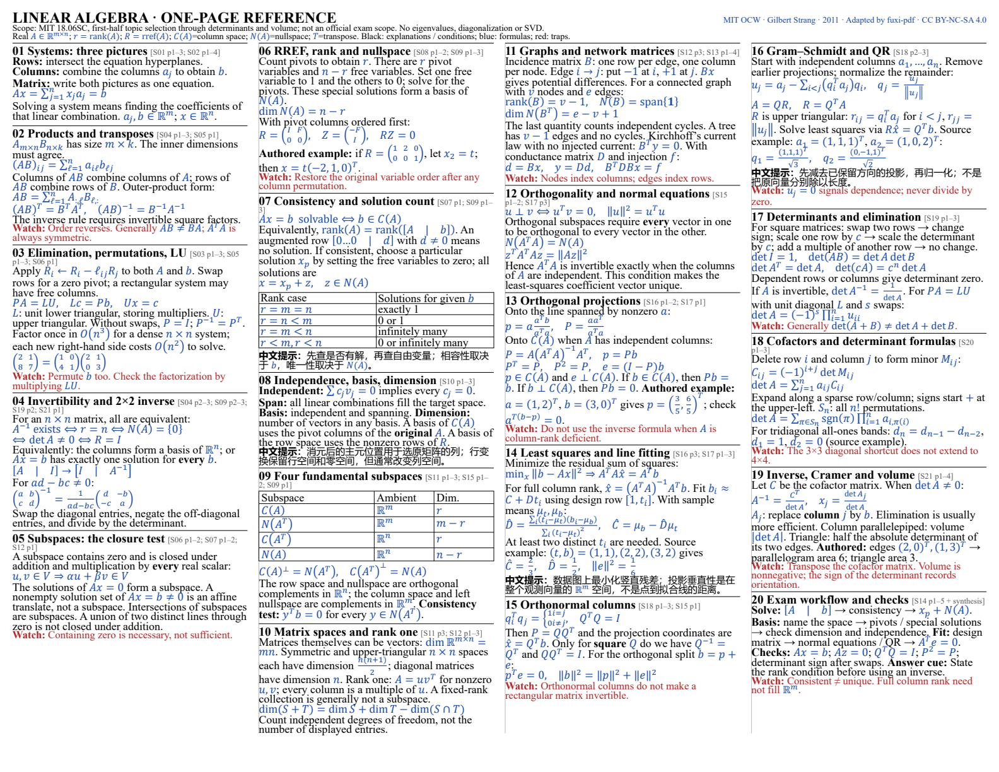

<p align="center">
  
</p>

<h1 align="center">fuxi-pdf · 复习pdf</h1>

<p align="center"><strong>把课件讲清楚，把重点整理成能打印的参考资料。</strong></p>

<p align="center">
  <a href="https://github.com/stevensun1005/fuxi-pdf/actions/workflows/validate.yml"></a>
  <a href="LICENSE"></a>
  <a href="references/sources.md"></a>
  
</p>

<p align="center">
  <a href="README.en.md">English</a> ·
  <a href="#先看真实成品">看成品</a> ·
  <a href="#快速开始">快速开始</a> ·
  <a href="#直接复制这些请求">复制请求</a> ·
  <a href="#常见问题">常见问题</a> ·
  <a href="SKILL.md">Skill 入口</a>
</p>

**fuxi-pdf 是一个 Codex skill**，把你提供的课件、教材和考试说明，做成逐页教学 PDF、紧凑 cheatsheet 或详细复习资料。它把原页、讲解、公式条件和来源对应起来，并保留可编辑稿，方便继续修改。

适合从零补课、整理一学期材料、把英文课程讲明白，以及按实际纸张限制准备参考资料。**页数和语言由你选**：英文为主、中文解释较多、完整中英双语，都可以。

## 三种成品，解决三种需要

| 你现在需要什么 | 成品 | 排版与内容 |
| --- | --- | --- |
| 每张课件到底在讲什么 | **逐页精讲** | 原课件在上，分节解释在下；讲机制、图示、例子与易错点 |
| 把公式和方法压进指定页数 | **紧凑 Cheatsheet** | 多栏、窄边距、三色区分；公式、条件、解题步骤与短例密排 |
| 系统复习并快速查阅 | **详细考场资料** | 按概念组织，保留推理、比较、例子与答题表述；长册可附目录和索引 |

只要其中一种，就只做那一种；需要学习册和参考册，可以一起准备。三种成品均可按语言偏好调整，示例里的中英文比例不代表所有人的默认设置。

## 先看真实成品

### ① 单页公式纸：线性代数近半学期主题

**21 份公开讲义摘要 → 20 个检索主题 → 1 个 Letter 横向打印面。**

取材自 **MIT OpenCourseWare 18.06SC Linear Algebra（Fall 2011，Gilbert Strang）**，涵盖线性方程组、消元、子空间、投影、最小二乘、QR 与行列式。这个示例选择了**英文为主，仅 4 处难点补中文**，四栏三色、3.5 mm 边距，无底部页脚。

[**打开单页 PDF**](examples/compact-math/cheatsheet.pdf) · [可编辑源稿与复现](examples/compact-math/README.md) · [来源清单](examples/compact-math/sources.json) · [核验记录](examples/compact-math/validation.md)



这是接近半学期的**主题选段**，不是官方期中考试范围；完整证明和多数原例已省略，具体取舍有台账。来源共 85 个 PDF 页面，其中 21 页为署名/许可页。

### ② 学习册与详细参考册：完整一讲的两种整理方式

下面是另一份示例：**MIT OCW 6.033 Computer System Engineering（Spring 2018，Katrina LaCurts）第 14 讲**。全讲 15 页，生成 **15 页中文逐页精讲**和 **10 页中英双语详细考场册**。

<details>
<summary><strong>展开预览：原页在上、讲解在下，以及详细双语参考册</strong></summary>

| 逐页精讲 · 原页 12：RAID 4 | 不限页双语详细册 · 第 3 页：可用性 |
| --- | --- |
|  |  |
| [打开 15 页学习册](examples/output/slide-walkthrough.pdf) | [打开 10 页详细参考册](examples/output/exam-reference.pdf) |

</details>

详细册含 7 个考点、14 道自编英文短答、印刷目录、英文索引和原页定位。这是独立的详细版，和上面的单页公式纸展示不同密度与语言选择。

课件公开适配版保留全讲顺序：原第 9 页中不在开放许可内的厂商图片替换为明确标注的文字适配，其余 14 页保留原图。出处、改编与许可见 [演示说明](examples/README.md) 和 [课程素材许可](licenses/MIT-OCW-demo-LICENSE.md)。

## 快速开始

### 1. 安装 Skill

需要支持本地 skills 的 Codex 环境，以及 Git。仓库根目录就是 skill，目录名保留为 `fuxi-pdf`。

**macOS / Linux**

```sh
mkdir -p "${CODEX_HOME:-$HOME/.codex}/skills"
git clone https://github.com/stevensun1005/fuxi-pdf.git \
  "${CODEX_HOME:-$HOME/.codex}/skills/fuxi-pdf"
```

**Windows PowerShell**

```powershell
$skillRoot = if ($env:CODEX_HOME) { Join-Path $env:CODEX_HOME 'skills' } else { Join-Path $env:USERPROFILE '.codex\skills' }
New-Item -ItemType Directory -Force -Path $skillRoot | Out-Null
git clone https://github.com/stevensun1005/fuxi-pdf.git (Join-Path $skillRoot 'fuxi-pdf')
```

已有同名目录时，先备份自己的修改，再更新；不要直接覆盖。界面显示名是 **复习pdf**，调用名是 **`$fuxi-pdf`**。新安装尚未在当前会话出现时，可新开会话再使用。

### 2. 提供材料

附上 PDF/PPTX 课件、教材或已提取的文本。有 syllabus、Revision、考试范围、纸张规则、Quiz 或往年题时一并提供，便于确定顺序与重点。

生成 PDF 还需要宿主具备读取、编译和渲染能力，以及合适字体。Skill 会检查环境；LaTeX 优先，也可使用 Typst，或遵从明确的 Markdown 输出要求。**安装 skill 不等于安装完整的 PDF 工具链。**

### 3. 直接说你要什么

```text
使用 $fuxi-pdf，帮我把这些课件做成复习 PDF 和 cheatsheet。
```

不必记模式名。未明确的页数与语言会先问；已有答案会沿用。你也可以一次把要求说完整，直接开始制作。

## 制作前，先选页数和语言

| 选择 | 可选项 | 会怎样处理 |
| --- | --- | --- |
| **Cheatsheet 页数** | 一页 / 两页 / 不限页，或其他明确预算 | 一页按一个打印面计算；一张纸双面是两页；限页内保留关键条件并说明取舍 |
| **语言偏好** | 英文为主 / 中文解释较多 / 完整中英双语 | 不从聊天语言、课件语言或考试语言推断整份资料的语言比例 |

两项都没说，就一次问齐；只缺一项，就只问缺的；已经明确的，不重复问。学习册和 cheatsheet 可以分别选语言，**一页不等于必须英文，不限页也不等于必须双语**。

一页公式纸通常采用横向 A4/Letter、多栏、窄边距和黑蓝红三色：正文与条件、核心公式、关键陷阱分层显示。已有样式参考或考试规定时，按你的要求调整。

## 直接复制这些请求

### 一页，英文为主

```text
使用 $fuxi-pdf，把这些线性代数材料整理成一页 Letter 横向 cheatsheet。
英文标题、公式条件、方法和答题句为主，只有繁琐或易混处补中文。
用多栏、窄边距、黑蓝红三色，不要页脚，保留必要公式条件和来源定位。
```

### 两页，中文解释较多

```text
使用 $fuxi-pdf，做两页 A4 cheatsheet，中文解释较多。
保留标准英文术语、公式和考试需要的英文答题短句。
优先放机制、选择方法的条件和易错点，不要逐句双语重复。
```

### 从零补课，再准备不限页双语参考册

```text
使用 $fuxi-pdf，准备学习册和考场参考册，我需要从零理解。
学习册：原课件在上，中文精讲在下，每页都解释，加入具体例子。
参考册：不限页数，完整中英双语，先中文机制，再英文答题表述。
保留可编辑源文件、来源页码和覆盖台账。
```

### 只解释每一页课件

```text
使用 $fuxi-pdf，逐页解释这份课件，只要学习册。
用中文讲清每个图、公式、代码和例子，保留英文术语，不需要英文复述。
```

## 为什么要保留来源和核验记录

**逐页有去向。** 每张源页登记为覆盖、重复、行政、空白或未决；限页版会记录压缩与省略，不用“覆盖了”暗示所有细节都在一张纸里。

**公式带条件。** 保留符号、单位、适用前提和边界；图表与推导回到原页核对，自编例子和练习明确标注。

**PDF 真正查看。** 编译后重新打开、渲染并看成品，检查中文缺字、分式、上下标、表格、重叠、截断和打印尺寸。文件存在、自动测试通过，都不替代视觉与内容复核。

**重点有依据。** 区分教师明确说明、题目中观察到的重点和整理者推断；自编短答不冒充官方答案或考试预测。

当前仓库的实际检查范围见 [验证记录](docs/validation.md)。演示来自公开真实课程，不使用用户的私人课程文件。

## 还支持哪些整理方式

| 模式 | 用途 |
| --- | --- |
| `study-pack` | 学习册 + 考场参考册，同源核验，语言分别选择 |
| `slide-walkthrough` | 原页在上，逐页讲解在下，保留原页顺序 |
| `exam-reference` | 按概念组织的打印参考资料，篇幅与语言按选择确定 |
| `summary` | 简短总结、重点速查或明确限页的 cheatsheet |
| `full` | 完整复习、速查、易错三册，以及课程图与覆盖报告 |
| `notes` | 概念引入、公式、方法、例题、练习与复盘的七步笔记 |
| `practice` | 练习题与独立答案册；足够依据下可按请求准备模拟卷 |

按请求选择合适模式，不强制扩展任务。只要一份 cheatsheet，就不会因为有 `full` 模式而额外生成一整套资料。

## 交付文件

按你选择的成品交付 PDF，并保留可编辑源稿和来源记录。例如请求学习册与参考册时：

```text
outputs/复习pdf-课程名/
├── slide-walkthrough.pdf     # 逐页精讲
├── exam-reference.pdf        # 可打印参考资料
├── … .tex / .typ             # 对应可编辑源稿
├── coverage.csv             # 源页到主题/成品位置的映射
└── coverage-report.md        # 压缩、排除、核验与限制
```

实际名称与格式可按要求调整。屏幕逐页册可能使用加长页面；打印册使用标准纸张，二者会明确区分。详细字段与模式结构见 [Skill 说明](SKILL.md) 和 [输出结构](references/output-schemas.md)。

## 常见问题

<details>
<summary><strong>它是独立软件、网页服务，还是 Skill？</strong></summary>

它是供 Codex 读取的指令、模板与素材包。内容理解和写作由宿主代理完成；仓库里的脚本负责特定验证与演示构建，不是一个安装后即可离线自动总结所有课程的 CLI。

</details>

<details>
<summary><strong>一页装不下所有内容怎么办？</strong></summary>

按全范围主题分配空间，保留有依据的重点、公式条件和高价值方法，说明省略内容。不会悄悄加背面、增加页数，或用截断公式和无限缩字换取“塞下了”。完整讲解可以另做学习册。

</details>

<details>
<summary><strong>可以全英文、中文偏多，或两本资料用不同语言吗？</strong></summary>

可以。未明确时先问；已有要求直接遵从。示例中的英文公式纸、中文精讲和双语长册，是具体选择，不是固定语言限制。

</details>

<details>
<summary><strong>扫描件、公式密集的材料能处理吗？</strong></summary>

取决于宿主可用的 OCR、读取与渲染工具。文字提取可用于检索，公式、图形和空间关系仍需看原页；无法可靠识别的内容会保留未决说明，不凭空补全。没有原件时也不会声称已完成原页视觉核验。

</details>

<details>
<summary><strong>这些演示能作为官方答案或直接带进考试吗？</strong></summary>

演示是独立编写的学习资料，不是官方答案。是否可携带、允许几页及单双面，以你提供的考试规定为准；“我想做不限页资料”本身不等于考试允许不限页。

</details>

## 开发与验证

Python 依赖用于仓库开发、演示检查与验证，不代表完整的 PDF 编译环境。

```sh
python -m pip install -r requirements-dev.txt
python tools/check_package.py
python -m unittest discover -s tests -v
python scripts/validate_coverage.py examples/coverage.csv --inventory examples/inventory.json
python scripts/validate_coverage.py examples/compact-math/coverage.csv --inventory examples/compact-math/inventory.json
```

[GitHub Actions](https://github.com/stevensun1005/fuxi-pdf/actions/workflows/validate.yml) 在 Python 3.11、3.13 上检查元数据、本地链接、覆盖脚本与演示 PDF。传入真实页数 inventory 后，覆盖验证器能发现整页漏记、未知来源与越界页码；不传 inventory 时只检查现有 CSV，不声称完整覆盖。

## 反馈与贡献

欢迎通过 [Issues](https://github.com/stevensun1005/fuxi-pdf/issues) 提交排版问题、复现失败、公式勘误或使用体验，也欢迎 [Pull Request](https://github.com/stevensun1005/fuxi-pdf/pulls)。报告问题时，说明操作系统、输出类型、页数/语言选择、复现步骤，以及可公开的最小样例。

修改 Skill 或文档时保持中英文说明一致；修改演示时同步源稿、PDF、预览和来源/许可说明，并检查最终渲染。具体结构见 [SKILL.md](SKILL.md)、[references/](references/) 与 [tests/](tests/)。

如果它帮你把一门课整理清楚了，欢迎点一个 Star，让更多有同样需求的人找到它。

## 许可与课程署名

| 内容 | 许可 |
| --- | --- |
| Skill 指令与构建/验证代码 | [MIT License](LICENSE) |
| MIT 6.033 课件公开适配版、讲解、派生 PDF 与预览 | [CC BY-NC-SA 4.0 · 作者与改编说明](licenses/MIT-OCW-demo-LICENSE.md) |
| MIT 18.06SC 数学 cheatsheet、源稿与预览 | [CC BY-NC-SA 4.0 · 作者与改编说明](licenses/MIT-OCW-math-LICENSE.md) |

第三方课程素材不会因仓库代码采用 MIT 而被重新许可。项目与 MIT 或课程教师无隶属或背书关系；字体文件不随仓库分发。完整素材声明见 [许可说明](references/sources.md)。
