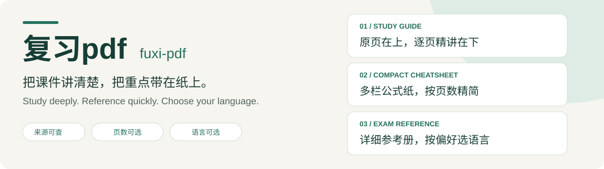
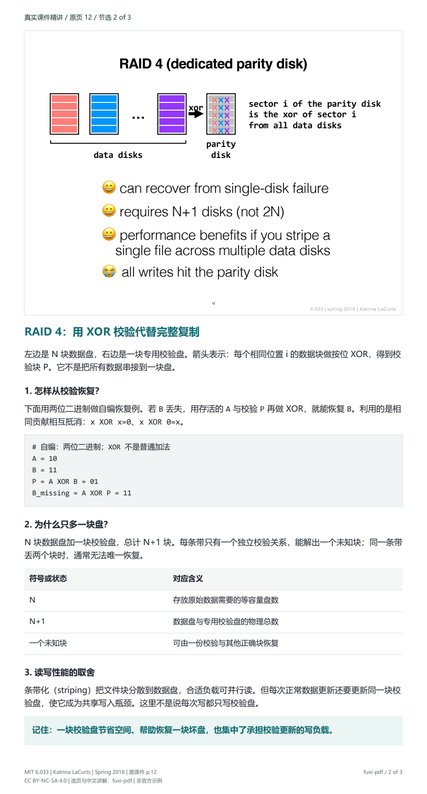
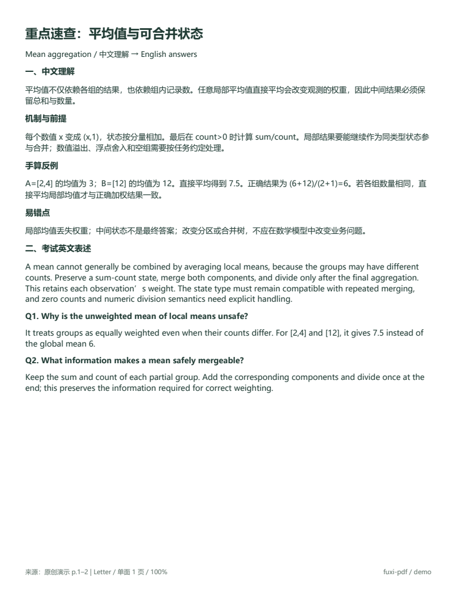
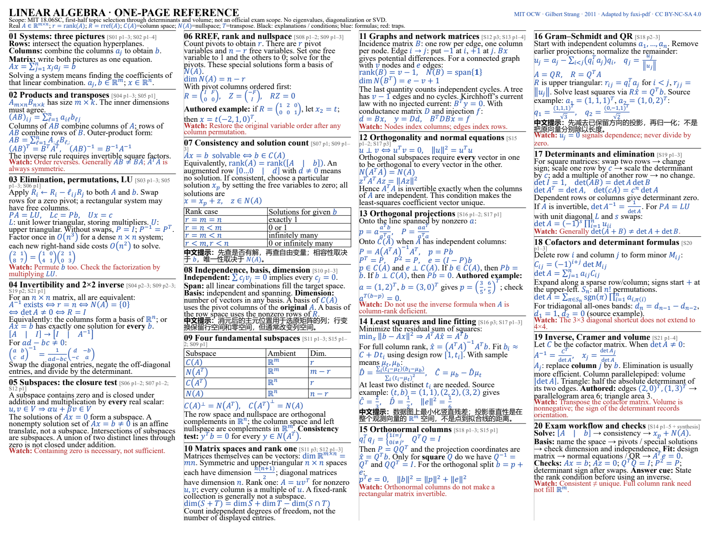

<p align="center"></p>

<p align="center">
  <a href="https://github.com/stevensun1005/fuxi-pdf/actions/workflows/validate.yml"></a>
  <a href="LICENSE"></a>
  <a href="licenses/MIT-OCW-demo-LICENSE.md"></a>
  
</p>

<p align="center"><b>从“这页在讲什么”，到“考试该怎么回答”。</b><br><a href="README.en.md">English</a> · <a href="SKILL.md">技能入口</a> · <a href="examples/README.md">真实 PDF 演示</a></p>

## 两种用途，两本资料

**复习pdf** 是一个面向 Codex 的学习资料技能。它读取你提供的课件、教材和考试说明，整理成有来源、有例子、经过核验的 PDF；尤其适合需要从零理解英文课程，再用英文参加考试的学习者。

| | 逐页精讲 · 学习册 | 考场重点 · Cheatsheet |
| --- | --- | --- |
| 读者要解决的问题 | 这张课件具体讲了什么？ | 这个概念怎样用英文答题？ |
| 结构 | 上方完整原课件，下方中文分节讲解 | 紧凑公式纸英文优先；不限页详细册中文机制之后给英文短答 |
| 组织 | 按讲次与原页顺序，逐页保留 | 合并重复，按考点检索，覆盖全范围实质主题 |
| 版式 | 竖版阅读，原页与解释明确对应 | 标准纸张；紧凑版多栏，详细册附目录和术语索引 |
| 语言 | 中文教学，保留必要英文术语 | 紧凑公式纸英文优先；不限页详细册先中文后英文 |

逐页精讲与不限页详细考场册采用理工科讲义风格：青色标题、编号小节、浅灰代码/伪代码块、字段与状态表格，以及“记住”提示框。紧凑公式纸另用多栏三色密排，英文和公式为主，少数难点补中文。代码、数据流与计算例子采用适当块状表达，不把普通正文全部代码化。

**Cheatsheet 未明确页数时，会先问你：“一页、两页，还是不限页数？”** 已明确的答案会沿用；“详细一点”“极简”或样式参考不等于页数要求。页数按打印面计算，一张纸双面是两页。

选一页时，默认采用 [紧凑型公式纸](references/compact-cheatsheet.md)：横向标准纸、多栏、窄边距，黑色解释、蓝色公式与英文句型、少量红色易错提醒。没有独立封面和目录；公式条件与打印可读性仍需核验。两页公式纸也默认英文优先；明确不限页的详细册才默认先中文解释再英文作答。明确的语言与版式要求优先。

## 看一眼成品

下面展示的是不限页详细册示例，不代表单页 cheatsheet 的密度。

以下演示使用 **MIT OpenCourseWare 6.033（Spring 2018，Katrina LaCurts）第 14 讲的完整 15 页课件及官方配套提纲**，覆盖故障模型、三步容错、可用性、MTBF、RAID 1/4/5 与可靠性取舍。逐页中文精讲共 **15 页竖版长页**；中英 cheatsheet 共 **10 页标准 Letter**，含 7 个考点、14 道自编英文短答、印刷目录、英文索引与原页定位表。

公开适配版保留全讲顺序。第 9 页明确排除开放许可的厂商图片替换为标注清楚的文字示意，原版仍可从官网获取；其余 14 页保留原图。讲解和补充例子由本项目编写，不是官方答案。下图分别预览精讲原页 12（RAID 4）和 cheatsheet 第 3 页（可用性）。

| 逐页中文精讲 | 可打印考场重点册 |
| --- | --- |
|  |  |
| [打开学习册 PDF](examples/output/slide-walkthrough.pdf) | [打开考场册 PDF](examples/output/exam-reference.pdf) |

[全讲公开适配版](examples/input/demo-slides.pdf) · [官方课件来源](https://ocw.mit.edu/courses/6-033-computer-system-engineering-spring-2018/resources/mit6_033s18lec14/) · [演示说明与复现](examples/README.md)

## 单页紧凑示例：数学课近半学期

另选 **MIT 18.06SC 线性代数**的前半段主题，覆盖几何、消元、子空间、投影、最小二乘与行列式。21 份真实讲义、85 个源页压缩为 **1 个 Letter 横向打印面**，四栏、黑蓝红三色，20 个检索小节，英文标题、公式、条件与步骤为主，只在少数难点补中文。

[打开单页 PDF](examples/compact-math/cheatsheet.pdf) · [源稿、来源与复现说明](examples/compact-math/README.md)



这是接近半学期主题的选段示例，不是官方期中范围；省略完整证明和多数原例，具体取舍有台账。上面的计算机系统 10 页详细册与这里的单页紧凑版各自展示一种成品密度。

## 安装

将本仓库放进 Codex 的技能目录，目录名保留 `fuxi-pdf`。仓库根目录就是技能入口，无需再找子目录。

**macOS / Linux**

```sh
git clone https://github.com/stevensun1005/fuxi-pdf.git ~/.codex/skills/fuxi-pdf
```

**Windows PowerShell**

```powershell
git clone https://github.com/stevensun1005/fuxi-pdf.git "$env:USERPROFILE\.codex\skills\fuxi-pdf"
```

已有同名安装时先备份，再更新。之后在支持本地技能的 Codex 会话中使用 `$fuxi-pdf`；界面显示名是“复习pdf”。生成 PDF 需要宿主可用的读取、编译和渲染能力，字体与后端会在实际任务中检查。

## 直接这样说

**学习和考场两册一起准备**

```text
使用 $fuxi-pdf，根据这些课件准备复习 PDF 和 cheatsheet。
我没上过课，需要从零讲清楚。
学习册每页上方放原课件，下方中文解释。
考场册详细一点，先中文解释，再给英文答题表述。
```

**只要逐页精讲**

```text
使用 $fuxi-pdf，解释这份课件的每一页。
上面原课件，下面中文分节讲解，加具体例子和易错点，不需要英文复述。
```

**只要限页考场资料**

```text
使用 $fuxi-pdf，做一份可打印的考场 cheatsheet。
最多两个 A4 打印面，可印在一张纸的正反面，考试使用英文。
英文写公式条件、关键区别和解题步骤，仅少数难点补中文。
```

提供课件，以及已有的 syllabus、Revision、考试规则或真题即可。资料不齐时会说明边界，不编造出题频率、官方答案或成绩保证。

## 支持的模式

| 模式 | 用途 |
| --- | --- |
| `study-pack` | 学习册 + 考场册，同源核验、不同语言组织 |
| `slide-walkthrough` | 原页在上、中文逐页解释在下 |
| `exam-reference` | 详细考点、中文机制、英文短答、打印检索 |
| `summary` | 简短总结或明确限页速查 |
| `full` | 完整复习、速查、易错三册及课程图 |
| `notes` | 七步章节笔记、概念与练习 |
| `practice` | 题目与答案分开的练习卷 |

明确的范围、页数和语言要求优先；只请求一本就不会强制做整套。默认保留 PDF 与可编辑源文件，支持 LaTeX，也可按要求使用 Typst 或 Markdown。

## 怎样避免“看起来做完了”

- **逐页有去向**：每张源页登记为覆盖、重复、行政、空白或未决，不只统计已有记录。
- **解释有条件**：定义、机制、适用条件、例子和反例一起核对，图中的箭头要逐条读。
- **英文能作答**：直接回应概念题，保留决定结论的条件，而非机械翻译整页中文。
- **PDF 真正检查**：实际编译、重开、渲染并查看成品页；自动校验不等于视觉核验。
- **重点有证据**：区分教师明确要求、题目观察和整理推断，不把推测写成教师承诺。

随附脚本可以检查台账。传入真实页数后，还能发现**完全漏记的一页**：

```sh
python scripts/validate_coverage.py examples/coverage.csv --inventory examples/inventory.json
```

`inventory.json` 格式为 `{"Lecture01": 30, "Lecture02": 42}`。不传 inventory 时只检查现有 CSV，不声称完整覆盖。脚本不评判公式或教学质量。

## 开发与验证

```sh
python -m pip install -r requirements-dev.txt
python tools/check_package.py
python -m unittest discover -s tests -v
```

GitHub Actions 在 Python 3.11、3.13 上执行元数据、链接、覆盖脚本与演示 PDF 检查。仓库包含实际演示产物；它是技能与素材包，完整课程的内容生成由宿主代理完成，不是一个离线自动总结 CLI。

本次实际执行的编译与视觉检查范围见 [验证记录](docs/validation.md)。

## 许可

技能与构建代码采用 [MIT License](LICENSE)。真实课件公开适配版、演示讲解与其 PDF/预览采用 [CC BY-NC-SA 4.0](licenses/MIT-OCW-demo-LICENSE.md)。线性代数紧凑示例另见 [数学示例许可](licenses/MIT-OCW-math-LICENSE.md)。其他素材声明见 [许可说明](references/sources.md)。
